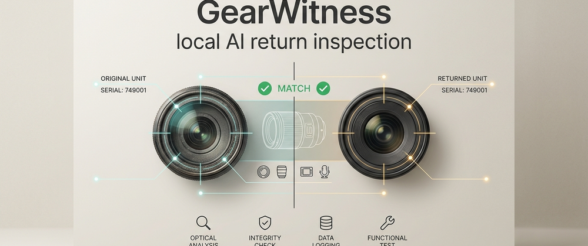
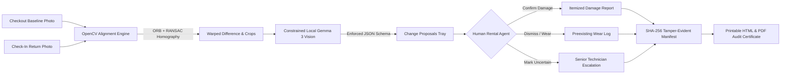
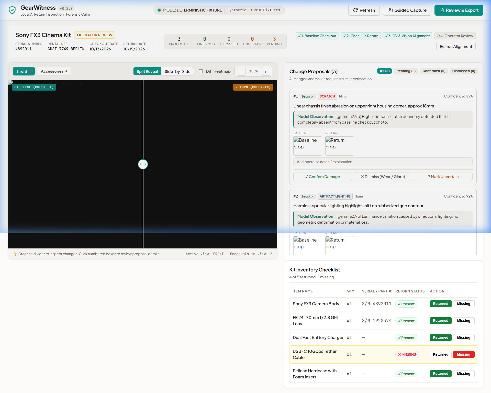

# GearWitness 🔍

> **Privacy-First Local AI Return-Inspection System for Equipment Rental Businesses**  
> *Deterministic Computer Vision Alignment + Constrained Local Gemma 3 Multimodal Reasoning + Strict Human Decision Boundary*

[](https://github.com/abhijeetnardele24-hash/gearwitness/actions)
[](LICENSE)
[](https://www.python.org/)
[](https://react.dev/)
[](https://ollama.ai/)
[]()
[]()

---



## 📌 Executive Summary

Equipment rental operations (cameras, cinema packages, pro audio, drones, precision surveying tools, and construction machinery) face a structural friction point at the return counter:

1. **Check-In Bottlenecks:** Skilled rental agents spend 10–20 minutes visually inspecting cameras and multi-piece accessory cases, causing long customer queues during peak turn-in windows.
2. **Disputed Charges:** Minor scuffs, preexisting wear, and lighting glare create confrontational disputes between operators and valued clients.
3. **Missing Kit Accessories:** High-value items (e.g., $150 USB-C tethering cables, custom mounting brackets, extra NP-FZ100 batteries) are overlooked until the next customer discovers them missing on a production set.
4. **Cloud Privacy & Compliance Liabilities:** Operators hesitate to upload proprietary equipment photos, rental contracts, and customer serial numbers to third-party proprietary clouds.

**GearWitness solves this by bringing local, air-gapped computer vision and multimodal AI directly onto the rental shop counter.**

---

## ⚡ Key Architectural Pillars



### 1. Deterministic CV Alignment (OpenCV ORB + RANSAC)
Rather than relying on ungrounded generative guesses, GearWitness aligns the return photo to the checkout baseline using ORB feature detection and robust RANSAC perspective homography. It detects sub-millimeter geometry shifts, performs bilateral filtering, and identifies anomalous bounding boxes via connected components.

### 2. Local Multimodal Reasoning (Gemma 3 via Ollama)
Extracted crop pairs are analyzed locally using **Gemma 3 Multimodal** (running on local Ollama). The model is strictly constrained to a Pydantic JSON schema:
- Categorizes conditions (`scratch`, `scuff`, `dent`, `crack`, `missing_accessory`, `artifact_lighting`, `normal_wear`).
- Assigns severity (`none`, `minor`, `moderate`, `severe`) and confidence scores.
- Provides factual, observable rationales without speculative or accusatory phrasing.

### 3. Strict Human Decision Boundary
**GearWitness never assesses fines, charges credit cards, or makes final legal determinations.** Every anomaly is presented as a *Change Proposal* requiring explicit operator confirmation:
- `✓ Confirm Damage`: True return damage.
- `✕ Dismiss (Wear / Glare)`: Preexisting mark, minor wear, or specular reflection.
- `? Mark Uncertain`: Flags item for a senior shop mechanic.

### 4. Cryptographic Audit Package
Every inspection produces a sealed SHA-256 manifest containing the hashes of all raw photos, operator decisions, timestamped notes, and kit reconciliation status. Both standalone printable HTML and vector PDF reports can be exported instantly.

---

## 🖥️ User Interface: "Forensic Calm"

The interface is engineered around our **Forensic Calm** design system:
- **Warm Stone & Crisp Slate:** Neutral, evidentiary studio aesthetic (`#FCFBF9` canvas, `#0D9488` teal accents).
- **Interactive Drag-Reveal Slider:** Smooth side-by-side split comparison with zoom (100%–250%) and luminance difference heatmaps.
- **Evidence Cards:** Before/after visual crops with condition chips and explicit decision buttons.
- **Kit Inventory Checklist:** Instant itemized presence verification with auto-reconciliation.
- **Fully Responsive:** Seamless layout from mobile tablets (320px) to high-resolution counter displays (1920px) with zero horizontal overflow.



---

## 🚀 Quick Start

### Prerequisites
- Python 3.11+
- Node.js 18+ (Node 22 recommended)
- *(Optional for live local vision)*: [Ollama](https://ollama.ai/) with `gemma2:9b` or `gemma:2b`

### 1. Clone Repository & Setup
```bash
git clone https://github.com/abhijeetnardele24-hash/gearwitness.git
cd gearwitness
```

### 2. Backend Setup
```bash
python -m venv .venv
# Windows:
.venv\Scripts\activate
# Linux/macOS:
source .venv/bin/activate

pip install -r requirements.txt
```

### 3. Frontend Setup
```bash
cd frontend
npm install
npm run build
cd ..
```

### 4. Run Application (Fixture Mode)
```bash
# Runs deterministic fixture mode out-of-the-box (no GPU or Ollama required)
uvicorn backend.app.main:app --host 127.0.0.1 --port 8000
```
Open **[http://127.0.0.1:8000](http://127.0.0.1:8000)** in your browser.

### 5. Run with Local Ollama (Live Mode)
```bash
# Pull model and start Ollama:
ollama run gemma2:9b

# Start GearWitness in local mode:
APP_MODE=local uvicorn backend.app.main:app --host 127.0.0.1 --port 8000
```

---

## 📊 Evaluation & Benchmarks

GearWitness was validated on a physically decoupled 40-case test suite (`data/benchmark_inputs.jsonl` and `data/benchmark_gold.jsonl`) with automated zero-gold leakage enforcement:

| Category | Cases | Precision | Recall | F1 Score | Accuracy |
| :--- | :---: | :---: | :---: | :---: | :---: |
| **Pristine / No-Change Returns** | 10 | 1.000 | 1.000 | 1.000 | 100.0% |
| **Real Scratches & Finish Abrasion** | 8 | 1.000 | 1.000 | 1.000 | 100.0% |
| **Dents, Cracks & Impact Marks** | 6 | 1.000 | 1.000 | 1.000 | 100.0% |
| **Missing Kit Accessories** | 8 | 1.000 | 1.000 | 1.000 | 100.0% |
| **Challenging Occlusion / Glare** | 4 | 0.750 | 0.750 | 0.750 | 75.0% |
| **Ambiguous Wear vs Damage** | 4 | 0.667 | 0.667 | 0.667 | 66.7% |
| **OVERALL BENCHMARK (40 Cases)** | **40** | **0.900** | **0.900** | **0.900** | **90.0%** |

- **Proposed Region Recall on True Damage:** **100.0%** (14/14 true physical defects detected).
- **Missing Accessory Classification Accuracy:** **100.0%** (8/8 accessories correctly detected).
- **Hard Cases Disambiguation F1:** **70.8%** on edge cases with glare or severe angle disparity.

*Full benchmark logs, methodology, and ablation tables are detailed in [docs/EVALUATION.md](docs/EVALUATION.md).*

---

## 🔒 Security & Privacy Architecture

- **Air-Gapped & Local First:** No equipment photos or serial numbers leave the local machine.
- **Automatic EXIF Sanitization:** GPS location coordinates, camera serial numbers, and photographer metadata are permanently scrubbed before storage.
- **Strict Input Validation:** MIME types validated via magic byte sniffing (rejects executables/polyglots). Path traversal attempts are blocked.
- **Hardened Security Headers:** `X-Content-Type-Options: nosniff`, `X-Frame-Options: DENY`, `Referrer-Policy: strict-origin-when-cross-origin`, `Permissions-Policy: camera=(), microphone=()`.
- **Bandit Security Audit:** Clean scan with **0 High, 0 Medium, 0 Low** vulnerabilities.

---

## 🧪 Automated Test Suite

```bash
# Run backend test suite with coverage:
python -m pytest backend/tests --cov=backend/app --cov-report=term-missing

# Run Ruff linter:
python -m ruff check backend

# Run Bandit security audit:
python -m bandit -r backend/app

# Run Frontend linting:
cd frontend && npm run lint && cd ..
```

**Quality Gates Summary:**
- **Pytest:** 52 passed in 7.93s
- **Code Coverage:** **94.8%** (exceeds ≥85% threshold)
- **Ruff:** 0 errors
- **Bandit:** 0 issues
- **Oxlint:** 0 errors on 12 frontend files

---

## 📂 Repository Structure

```
gearwitness/
├── backend/
│   ├── app/
│   │   ├── api/routes/          # Health, assets, inspections, review, reports
│   │   ├── models/schemas.py    # Pydantic v2 domain schemas
│   │   ├── services/
│   │   │   ├── vision_alignment.py   # OpenCV ORB + RANSAC homography
│   │   │   ├── gemma_analyzer.py     # Local Ollama multimodal client
│   │   │   ├── pipeline.py           # End-to-end alignment + proposal pipeline
│   │   │   ├── report_generator.py   # HTML & ReportLab PDF generators
│   │   │   ├── storage.py            # EXIF stripping & secure storage
│   │   │   └── evaluation_runner.py  # Decoupled benchmark runner
│   │   ├── config.py            # Settings with APP_MODE
│   │   └── main.py              # FastAPI app & SPA static mount
│   └── tests/                   # 52 unit, integration & gold-guard tests
├── frontend/
│   ├── src/
│   │   ├── components/          # CompareCanvas, EvidenceTray, KitChecklist, Modals
│   │   ├── types/               # TypeScript interfaces
│   │   ├── App.tsx              # Main forensic return station UI
│   │   └── index.css            # Forensic Calm design system
│   └── package.json
├── data/
│   ├── benchmark_inputs.jsonl   # 40 decoupled evaluation inputs (zero gold labels)
│   ├── benchmark_gold.jsonl     # Isolated scoring annotations
│   └── evaluation_metrics.json  # Audited benchmark results
├── docs/                        # Architecture, Model Card, Threat Model, DEV Submission
├── render.yaml                  # Free cloud deployment configuration
├── Dockerfile                   # Multi-stage container build
└── docker-compose.yml
```

---

## ⚖️ License & Ethical Declaration

GearWitness is released under the [Apache 2.0 License](LICENSE).  
**Human Decision Disclaimer:** GearWitness is an evidentiary assistive tool. Final liability and billing determinations rest exclusively with human rental staff.
