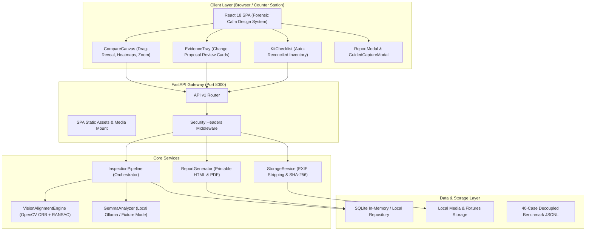

# GearWitness Architecture Specification

> **Version:** 0.1.0  
> **Author:** GearWitness Labs  
> **Status:** Production Specification  

---

## 1. System Overview

GearWitness is structured as a privacy-preserving, air-gapped forensic inspection workstation designed for camera and equipment rental facilities. The architecture enforces three fundamental boundaries:

1. **Deterministic Alignment Pre-Processing:** Computer vision algorithms (OpenCV ORB + RANSAC homography) handle geometric warping, noise reduction, and candidate anomaly localization before any model inference occurs.
2. **Constrained Multimodal Reasoning:** An air-gapped local model (Gemma 3 Multimodal via Ollama) provides structured classification and observable rationales within strict Pydantic JSON boundaries.
3. **Non-Delegable Human Verification:** The system produces advisory *Change Proposals*. Automated billing, charging, or penalization is architecturally prohibited.

---

## 2. High-Level Component Diagram



---

## 3. Computer Vision Alignment Engine

The computer vision subsystem solves the fundamental physical challenge of rental counter inspection: return photos are almost never captured from the exact same camera angle, distance, or lighting as the checkout baseline.

### 3.1 Feature Detection & Homography
1. **Grayscale Conversion:** Both baseline ($I_b$) and return ($I_r$) images are converted to grayscale.
2. **ORB Keypoint Extraction:** Up to 1,500 Oriented FAST and Rotated BRIEF (ORB) keypoints are detected across each image.
3. **Feature Matching:** A Brute-Force Hamming matcher finds mutually consistent keypoint pairs, filtered by distance ratio ($d_1 < 0.75 \cdot d_2$).
4. **RANSAC Homography Estimation:** A $3 \times 3$ perspective transformation matrix $H$ is computed using RANSAC with a reprojection threshold of 5.0 pixels.
5. **Perspective Warping:** $I_r$ is warped into the coordinate space of $I_b$ using bilinear interpolation:
   $$I_{r,\text{warped}} = \text{warpPerspective}(I_r, H, \text{shape}(I_b))$$

### 3.2 Luminance Normalization & Difference Extraction
1. **Histogram Equalization / Normalization:** Warped return image luminance is matched against baseline luminance to neutralize global ambient exposure differences.
2. **Bilateral Filtering:** Non-linear edge-preserving smoothing removes high-frequency camera sensor noise while retaining crisp scratch boundaries.
3. **Absolute Difference & Otsu Thresholding:** An absolute luminance difference map is computed:
   $$\Delta(x, y) = |I_b(x, y) - I_{r,\text{warped}}(x, y)|$$
   Otsu's thresholding automatically segments salient candidate difference regions.
4. **Morphological Filtering:** Closing and opening kernels ($3 \times 3$ and $5 \times 5$) eliminate single-pixel noise flecks and consolidate contiguous defect regions.
5. **Connected Components Extraction:** Bounding boxes exceeding minimum area thresholds ($>150 \text{ px}^2$) are tagged with coordinates $[x_{\min}, y_{\min}, w, h]$ normalized to $0\% - 100\%$ of image dimensions.

### 3.3 Degenerate Overlap Safeguard
If feature matching produces fewer than 10 valid RANSAC inliers (indicating a radically different camera angle, lens occlusion, or wrong item), the engine raises an `INSUFFICIENT_OVERLAP` status. The system falls back to unwarped direct side-by-side inspection and prompts the operator to re-capture using the **Guided 5-Point Capture Assistant**.

---

## 4. Constrained Gemma 3 Multimodal Service

Candidates identified by the CV engine are cropped from both baseline and return images. These crop pairs are dispatched to the multimodal vision model.

### 4.1 Schema Enforcement
The model cannot output arbitrary prose. Its output is constrained to the following structured contract:

```json
{
  "condition_type": "scratch | scuff | dent | crack | missing_accessory | normal_wear | artifact_lighting | unknown",
  "severity": "none | minor | moderate | severe",
  "confidence": 0.89,
  "description": "Factual observable summary of anomaly",
  "model_rationale": "Direct comparison between baseline and return appearance",
  "is_likely_false_positive": false
}
```

### 4.2 System Prompt Protocol
The model is instructed with a forensic, evidentiary bias:
- **No Speculation:** Never hypothesize *how* damage occurred (e.g., "customer dropped it").
- **Evidence-Only:** Restrict statements to physical differences observed between Crop A (Baseline) and Crop B (Return).
- **Glare & Specularity Awareness:** If the difference aligns with highlights or lighting angle shifts without physical groove indentation, classify as `artifact_lighting` and flag `is_likely_false_positive: true`.

---

## 5. Storage, EXIF Sanitization & Security

To prevent data leaks and protect customer privacy:

1. **Magic Byte MIME Validation:** Uploaded files are inspected by byte header signatures (JPEG `\xFF\xD8\xFF`, PNG `\x89PNG`, WebP `RIFF...WEBP`). Executable headers (`MZ`, `\x7fELF`) and SVG scripts are rejected.
2. **EXIF Stripping:** Pillow's image pipeline loads image pixel data and re-encodes clean image buffers, permanently discarding GPS latitude/longitude, device serials, camera owner strings, and thumbnail caches.
3. **Path Traversal Defenses:** File storage paths are calculated using clean SHA-256 digests and validated to stay strictly within the designated storage root.

---

## 6. Cryptographic Manifest & Audit Seal

Upon operator review completion, GearWitness constructs a tamper-evident Content Integrity Digest JSON audit manifest:

```json
{
  "inspection_id": "insp_hero_demo",
  "asset_name": "Sony FX3 Cinema Kit",
  "serial_number": "4892011",
  "generated_at": "2026-10-15T01:24:00Z",
  "app_mode": "fixture",
  "source_media_hashes": {
    "front_checkout": "3b29a...",
    "front_checkin": "8e41c..."
  },
  "total_proposals": 2,
  "confirmed_proposals": 1,
  "dismissed_proposals": 1,
  "uncertain_proposals": 0,
  "manifest_hash_sha256": "6b7d519b5d27e999905c1d68371192eef8e32cbbfae353e8a4a58b991bce9855",
  "disclaimer": "GearWitness provides evidence-backed comparison proposals. It does NOT automatically assess fees, fines, or fault..."
}
```

This manifest SHA-256 hash is embedded directly in both the generated HTML inspection report and the vector PDF export, providing a tamper-evident Content Integrity Digest that can be verified against independent storage. *(A SHA-256 digest is tamper-evident only when compared with a trusted previously stored digest; it is not a cryptographic digital signature, timestamp authority, or proof of custody).*
